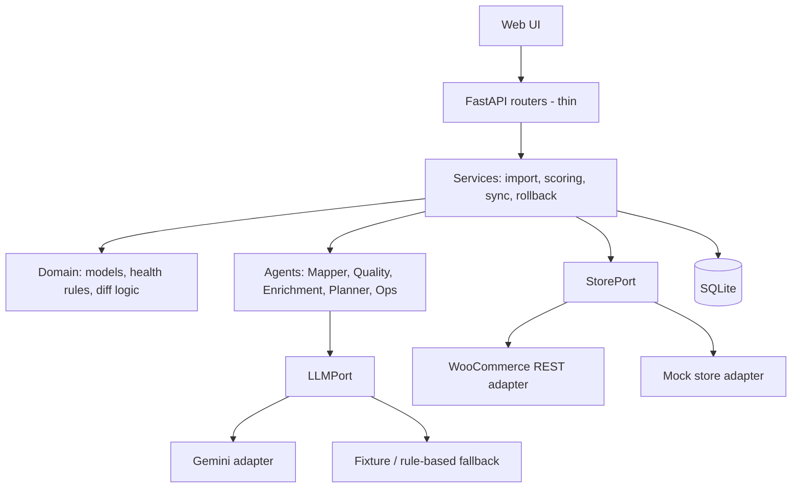

# CatalogPilot

**An agentic PIM (Product Information Management) system that cleans, scores and safely syncs product data to WooCommerce.**

Built for a 3-hour hackathon. The problem statement: *analyse, design and implement a PIM system that integrates with WooCommerce*, covering product catalog management, attribute handling and data synchronization.

> **Core principle: agents propose, deterministic code executes.**
> AI helps with the messy parts (mapping columns, normalizing values, explaining issues). It never writes price, SKU or stock, and nothing reaches the store without a reviewed and approved sync plan.

---

## What makes it different

| Feature | Why it matters |
|---|---|
| **AI Mapper Agent** | Reads any messy supplier CSV, maps columns (`Clr` → Color, `Sz` → Size) and normalizes values (`x-large` → XL). |
| **Catalog Health Score** | Rule-based 0-100 score per product with explainable issues, giving measurable before/after quality. |
| **Plan → Approve → Sync → Rollback** | Sync is a dry run with a field-level diff and a risk summary. Execution takes a snapshot first, so any run can be rolled back. |
| **Idempotent sync** | Products are matched by SKU, so re-running a sync creates no duplicates. |
| **Human-in-the-loop** | Risky items (e.g. duplicate SKUs with conflicting prices) are held for review, never auto-fixed. |
| **Ports and adapters** | The store and the LLM sit behind interfaces, each with a real and a mock adapter. Tests and demos work offline. |

---

## Project status

Be upfront about what is built. Update this table as you go.

| Area | Status |
|---|---|
| Catalog CRUD (products, categories, attribute definitions) | Done, with tests |
| Database models, seed data, config, error handling | Done |
| PRD and ADRs | Done (`docs/`) |
| CSV import with Mapper Agent | In progress / planned |
| Health Score and Quality Agent | In progress / planned |
| Sync planning, approval, mock store, rollback | In progress / planned |
| Live WooCommerce adapter | Roadmap |
| UI prototype (hardcoded demo data) | Done, demonstrates the full intended flow |

---

## Architecture



**Layers**

- `api/`: thin FastAPI routers. No business logic.
- `services/`: use cases (product, category and attribute management; import; scoring; sync).
- `domain/`: schemas, exceptions and pure logic (health rules, diffing).
- `adapters/`: implementations of `StorePort` and `LLMPort`.
- `agents/`: AI agents whose output is validated with Pydantic before use.
- `db/`: SQLModel tables, session handling, seed script.

Every design decision is recorded as an ADR in [`docs/adr/`](docs/adr/).

---

## Sync lifecycle

```
Plan (dry run, immutable diff)  →  Review risk summary  →  Approve
      →  Snapshot current state  →  Execute (batched, matched by SKU)
      →  Log results  →  Rollback available
```

- Creates, updates and no-change items are shown with field-level diffs.
- Re-planning after a successful sync shows **zero changes**.
- Rollback restores snapshots; newly created products are removed.

---

## Getting started

**Requirements:** Python 3.12+

```bash
# 1. Clone and enter the project
git clone <your-repo-url>
cd killowott

# 2. Create a virtual environment
python -m venv .venv
source .venv/bin/activate        # Windows: .venv\Scripts\activate

# 3. Install dependencies
pip install -r requirements.txt

# 4. Configure environment
cp .env.example .env

# 5. Seed sample data (optional) and run
make seed
make run
```

The API runs at `http://localhost:8000`. Interactive API docs are at `http://localhost:8000/docs`.

### Make commands

| Command | Purpose |
|---|---|
| `make run` | Start the FastAPI dev server with reload |
| `make test` | Run the pytest suite |
| `make lint` | Run ruff and mypy |
| `make format` | Auto-format with ruff |
| `make seed` | Seed the database with sample products |
| `make clean` | Remove caches |

---

## Configuration

Set values in `.env` (never commit real keys; commit only `.env.example`).

| Variable | Description | Default |
|---|---|---|
| `DATABASE_URL` | SQLite connection string | `sqlite:///./catalogpilot.db` |
| `STORE_MODE` | `mock` or `live` | `mock` |
| `WOOCOMMERCE_URL` | WooCommerce site URL (live mode) | `http://localhost:8080` |
| `WOOCOMMERCE_CONSUMER_KEY` | REST API key, starts with `ck_` | placeholder |
| `WOOCOMMERCE_CONSUMER_SECRET` | REST API secret, starts with `cs_` | placeholder |
| `LLM_PROVIDER` | LLM provider | `gemini` |
| `GEMINI_API_KEY` | Gemini API key | empty |

**Getting WooCommerce keys (live mode only):** in WP Admin go to *WooCommerce → Settings → Advanced → REST API → Add key*, choose **Read/Write**, and copy both values immediately because they are shown once. Permalinks must not be set to "Plain". Over plain HTTP on localhost, pass the keys as query parameters; Basic auth requires HTTPS.

With `STORE_MODE=mock`, no WooCommerce instance is needed.

---

## API overview

Interactive docs at `/docs`. Currently implemented resources:

| Resource | Endpoints |
|---|---|
| Products | `GET/POST /api/products`, `GET/PUT/DELETE /api/products/{id}` |
| Categories | `GET/POST /api/categories`, `GET/PUT/DELETE /api/categories/{id}` |
| Attributes | `GET/POST /api/attributes`, `GET/PUT/DELETE /api/attributes/{id}` |

Planned: `/api/imports/preview`, `/api/imports/commit`, `/api/health`, `/api/sync/plan`, `/api/sync/{plan_id}/execute`, `/api/sync/runs`, `/api/sync/runs/{id}/rollback`.

Validation rules include unique SKUs (409), attribute values checked against allowed values (422) and protection against circular category hierarchies (422).

---

## Sample data

[`sample_data/messy_supplier.csv`](sample_data/messy_supplier.csv) is a deliberately dirty supplier file used to demonstrate the Mapper Agent:

- 30 rows, 8 columns, 12 unique products (size and color variants share a SKU)
- Cryptic headers (`Clr`, `Sz`, `Cat.`, `MRP (Rs)`)
- Mixed formats: `blk` / `BLK` / `Black`, `x-large` / `med`, `Rs. 799/-`, `₹1,499`
- Missing sizes and descriptions
- A duplicate SKU conflict (`HD-004`, rows 14 and 27, with different prices)

---

## Testing

```bash
make test
```

The suite covers CRUD behaviour, validation and error handling for products, categories and attributes. The planned integration test for sync is: import → plan → execute → re-plan must show zero changes.

---

## Project structure

```
.
├── app/
│   ├── api/          # routers
│   ├── services/     # use cases
│   ├── domain/       # schemas, exceptions, pure logic
│   ├── adapters/     # StorePort / LLMPort implementations
│   ├── agents/       # AI agents
│   ├── db/           # models, session, seed
│   ├── config.py
│   └── main.py
├── docs/
│   ├── PRD.md
│   └── adr/          # architecture decision records
├── sample_data/
├── tests/
├── Makefile
├── rules.md          # coding rules used with the AI IDE
└── requirements.txt
```

---

## Documentation

- [Product Requirements Document](docs/PRD.md)
- [Architecture Decision Records](docs/adr/): stack, ports and adapters, WooCommerce batch sync, human-in-the-loop agents, LLM abstraction, sync lifecycle, health score, UI approach, environment fallback

---

## Roadmap

- Live WooCommerce adapter (REST v3 batch endpoint, SKU lookup, retries)
- Enrichment Agent (suggested descriptions and SEO titles, never auto-applied)
- Natural-language bulk edits with preview (e.g. "raise Hoodie prices by 10%")
- Import existing WooCommerce products into the PIM
- MCP server exposing PIM tools to external agents
- Postgres support through the repository layer

---

## Built with

Python, FastAPI, SQLModel, SQLite, Pydantic, pytest, ruff, mypy. Developed with Google Antigravity and the guardrails in `rules.md`.
